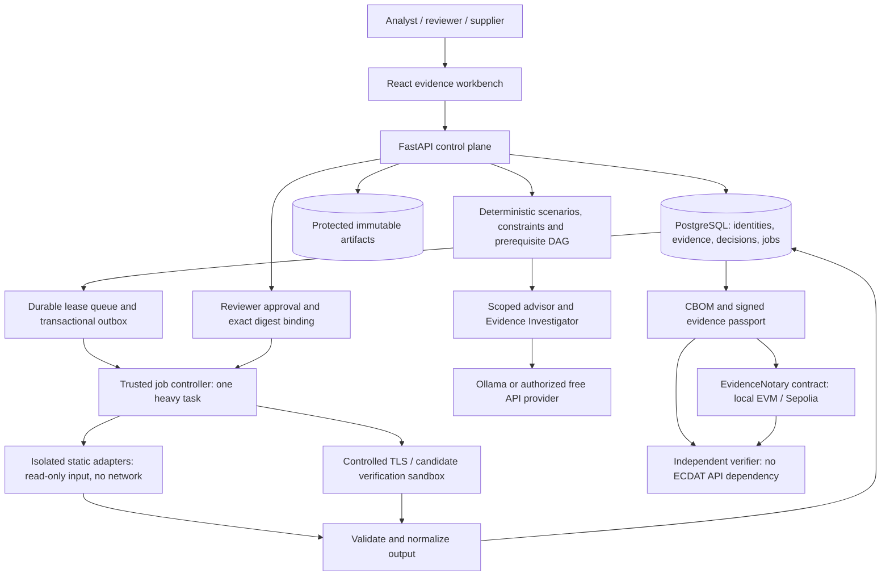

# ECDAT end-to-end architecture

Decision date: 20 September 2026. Status: implementation specification; runtime and performance claims require executed evidence. User scope: all six innovations, working advisor, Evidence Investigator, blockchain, custom console, backend correctness first. Target: Windows laptop, 8 GB RAM, GTX 1650 with 4 GB VRAM.

## 1. Product and trust boundaries

The workflow is project login → immutable intake → durable scan → evidence and coverage → lineage/conflicts → attributed context → interval scenarios → feasible alternatives → prerequisites → cited advice/investigation → exact proposal → separate reviewer → candidate copy → rescan and behavior tests → CBOM/passport → independent verification/replay.

Inventory, policy, authorization and acceptance are deterministic. AI proposes explanations and permitted investigations. Blockchain records commitments and authorized statements; it does not establish the truth of scanner output. The console renders persisted records. All unavailable or inconclusive results remain visible.

There are four explicit trust zones: browser/user identities; trusted control plane and metadata database; untrusted artifact parsers; independent reviewer/ledger/verifier. Parser jobs receive neither database credentials, AI credentials nor wallet keys. The trusted controller may launch fixed sandbox profiles; submitted artifacts never choose image names, commands, mounts or network targets.

## 2. Technology decisions and 8 GB profile

Use a modular Python backend, not one service per feature. FastAPI/Pydantic serves one API; SQLAlchemy/Alembic defines the schema; PostgreSQL is the deployed authoritative database. React/TypeScript/Vite forms the console. Raw artifacts live behind a content-addressed storage interface. The evidence graph and lexical retrieval use PostgreSQL rather than separate graph/vector servers.

ADR-001: use a database-backed durable lease queue instead of Celery/Redis in the initial 8 GB deployment. This replaces infrastructure, not the required job contract. Jobs, events and outbox records are transactional; workers claim with lease/version fencing, bounded retries, cancellation and idempotency. PostgreSQL uses `FOR UPDATE SKIP LOCKED`. SQLite is permitted only as a native developer/test profile using a single worker and explicit fixture-only execution; it is not represented as the production database or as proof of multi-worker behavior. Avoid implementing two queue systems at once.

ADR-002: static work executes inside fixed Linux container profiles, read-only inputs, non-root, dropped capabilities, no new privileges, no network, bounded CPU/RAM/time/output. The API has no Docker socket. A trusted host controller launches allowlisted images; parser children have no daemon access. Native mode supports controlled authored fixtures only until equivalent isolation is verified. No package installation/build hooks from an upload run.

ADR-003: local AI is on demand, one request and one loaded model, bounded context, unload after use. Larger inference uses configured free APIs for public/demo or explicitly exportable context. Private restricted context stays local. Provider changes cannot change the server's evidence/approval rules. The user explicitly allows a remote provider when hardware restricts local AI, so A12 is broadened to an actual approved provider run; local adapter support remains required, and local/remote evidence is labeled separately.

ADR-004: blockchain uses a small non-upgradeable EvidenceNotary contract. Local EVM supplies reproducible contract execution. Sepolia supplies an externally witnessed testnet path, with no full node on the laptop. No token, NFT market, mining or heavy consortium cluster is needed.

Initial memory allocations are planning ceilings, not benchmarks:

| Process/profile | Budget target |
| --- | --- |
| Windows and working headroom | Reserve at least 3 GB; measure actual available memory before launching jobs |
| API and job controller | 250–450 MB |
| PostgreSQL | 250–450 MB, small connection pool |
| One scanner/verification task | 500–1200 MB, adapter-dependent hard cap |
| Browser with bounded graph/list | 250–500 MB |
| Local EVM | 150–300 MB target, measured before promising |
| WSL/container overhead | Measure; share one Linux VM, no duplicate engine stacks |
| Local model | Additional on-demand RAM/VRAM; never assume 4 GB VRAM means free system RAM |

The controller admits a heavy task only if the profile budget and free-memory reserve permit it. Heavy scans, TLS benchmarks, local model inference and browser test suites run sequentially by default. Low-memory tasks queue with an explicit reason; nothing is silently skipped. Build the web bundle once for demonstrations. Scanner breadth remains available through sequential runs. Unlimited corpus size, concurrency, model quality or uninterrupted free-cloud capacity cannot be guaranteed on this hardware.

## 3. Modules and repository boundaries

| Area | Ownership and responsibility |
| --- | --- |
| `services/api/ecdat` | API, identity, project authorization, schemas, persistence, artifacts, jobs, domain services, governance and exports |
| `services/api/ecdat/discovery` | Adapters and their explicit coverage contract, no API/database access from parser children |
| `apps/web` | Typed API client, evidence workbench, review and independent verification interface |
| `packages/chain` | Solidity contract, ABI, local deployment/test scripts and RPC adapter |
| `packages/verification` | Trusted TLS harness, fixture generation and replay helpers |
| `policies`, `recipes`, `knowledge` | Versioned deterministic rules, bounded recipes and attributed source excerpts |
| `fixtures`, `tests`, `scripts` | Licensed/authored inputs, behavioral tests and reproducible run commands |
| `docs` | Decisions, implementation status, acceptance matrix, operator instructions |

The lead integrates schemas/database migrations. Parallel agents work in disjoint areas and return executed test evidence. Core verification is reviewed independently of its author.

## 4. Data and immutable identity

All tenant-owned rows contain project identity and timestamps. Every object lookup is scoped server-side; knowing a UUID or digest is never authorization. Records include projects/memberships, immutable artifact versions/manifests, jobs/adapter attempts, stable crypto entities, versioned assertions, typed edges, conflicts, attributed business context, scenario assessments, candidate registry snapshots, prerequisite tasks, advice/investigations, proposals, reviewer decisions, candidate/verification attempts, audit events, exports and chain submissions.

Artifacts are identified by immutable ID plus SHA-256 content/manifest digests. Relative file paths are locations, not identities. Cross-project deduplication must not leak file presence. Original/candidate/export namespaces have separate access policies. Manifests retain normalized path, byte digest, size, kind, eligibility and extraction result. Private keys produce protected metadata and never enter model prompts or public exports by default.

Use a verified RFC 8785 serializer for supported JSON. Reject nonfinite floats, duplicate JSON keys at boundaries and ambiguous types. Every signed/hash payload has a schema version and a domain such as `ecdat.proposal.v1`. Persist the exact canonical digest inputs. Timestamps and random IDs are excluded from reproducibility claims unless explicitly bound.

An assertion contains `id, entity_id, artifact_id, file_digest, subject, predicate, value, crypto_role, evidence_type, scope, location, adapter_version, rule_version, observed_at, confidence_basis`. Evidence types distinguish package presence, implementation/symbol presence, static references, configuration, imported declarations and observed runtime behavior.

## 5. API, access and transaction contracts

Use opaque session cookies with HttpOnly, SameSite and CSRF protection for browser writes; hash passwords with a maintained password KDF and throttle authentication. Create local demo identities explicitly with clearly documented demo-only credentials. Roles: viewer, analyst, reviewer, administrator; supplier attestation identity is separate from verified organizational independence. Analysts cannot approve their own proposals, even if they also have reviewer privileges.

All errors use `{error:{code,message,details,request_id}}`. Long operations return 202 and job ID. Job events support bounded polling initially and SSE where tested. Pagination and graph limits are server-enforced. Browser source/code/model text is escaped.

| API group | Contract |
| --- | --- |
| `/api/auth`, `/api/projects` | Sessions, current user, memberships and permitted targets |
| `/api/artifacts` | Bounded upload, immutable manifest, authorized metadata/download |
| `/api/jobs` | Idempotent creation, progress, coverage, cancel, attempts/events |
| `/api/findings`, `/api/evidence`, `/api/graph`, `/api/conflicts` | Scoped inventory, exact excerpts, local neighborhoods and retained resolution decisions |
| `/api/context`, `/api/assessments` | Attributed context revisions and named interval scenarios |
| `/api/candidates`, `/api/plans` | Deterministic feasibility, exclusions, shared prerequisites and cycles |
| `/api/advice`, `/api/investigations` | Validated AI responses and requests for registered checks |
| `/api/proposals`, `/api/decisions` | Exact diff, acceptance contract, separate authenticated review |
| `/api/migrations`, `/api/verifications` | Approved copied change, claim results and residual risks |
| `/api/exports`, `/api/passports`, `/api/anchors` | CBOM, evidence bundles, checkpoint and separate ledger state |

Job creation writes job+outbox+audit in one transaction. Claiming assigns a fencing token and lease deadline. A worker commits only while its token/state is current. Cancellation invalidates finalization and terminates the child process tree. Content-addressed candidate creation and unique proposal-attempt constraints prevent duplicate completed effects. Immutable decisions cannot be overwritten by retries. Database recovery and worker restart tests are mandatory.

## 6. Intake and discovery

Validate file counts, decompressed size, per-file size, nesting depth and compression ratio. Reject absolute paths, traversal, drive-qualified names, device files, duplicate normalized names and symlinks for the initial archive profile. Inspect ZIP/tar metadata without executing content. Stream to temporary storage, validate, hash, then atomically finalize. Detect secret/private-key material and enforce protected-artifact rules before snippets or exports.

Each adapter returns `assertions, relationships, coverage, errors, warnings, tool_versions, raw_output_digest`. Coverage is per file and adapter, with applicability, status, reason and version. Partial output survives individual failures. No adapter tool present means `unavailable`/unsupported evidence, never a passed scan.

Required adapters: Python AST with imports/aliases/known API calls; documented JS/TS grammar/rules; Syft directory/OCI archive inventory; selected ELF imports/symbols; PEM/DER certificates/public keys; structured supported TLS configuration; controlled actual TLS observation; attributed supplier/cloud/HSM imports. Rules never treat comment strings or a crypto package as confirmed executed cryptography. Stripped binaries and dynamic parameters retain uncertainty.

## 7. Six deterministic innovations

1. **Coverage-preserving acceptance.** Compare input scope and per-adapter parsing before/after. Required claims: original preserved, approval fresh, expected patch only, required scope present, no unexplained parser regression, targeted replacement evidenced, prohibited behavior absent at tested boundary, functional/peer checks, residuals retained. Each is passed/failed/blocked/inconclusive/not-applicable. Rule changes require a compatible comparison policy or a new baseline.
2. **Contradiction-preserving graph.** Compare only compatible entities, roles, deployment/peer scope and time windows. Capability plus classical observation is an expectation mismatch only if a relevant expectation exists. Hybrid exchange with RSA authentication is a residual different role, not a conflict. Resolution appends a decision.
3. **Scenario engine.** Nonnegative, unit-normalized intervals: `D=[Xlow+Ylow-Zhigh, Xhigh+Yhigh-Zlow]`. `Dlow>0` is triggered throughout; `Dhigh<=0` is not triggered in the ranges; otherwise scenario-dependent. Missing inputs produce insufficient context. Criticality/exposure and evidence confidence remain separate dimensions.
4. **Candidate engine.** Filter role, implemented protocol, runtime/provider, peer, HSM/platform and hard resource constraints before ranking. Retain exclusions and unknown measurements. KEM is never a signature replacement. Registry sources and measurements are versioned.
5. **Portable replay.** Bundle original/candidate input snapshots or authorized resolvable references, full manifests, claims, versions, proposal/decision binding, raw outputs, policy, recipe, CBOM, audit checkpoint and environment. Missing inputs make affected replay claims unavailable. Fresh TLS observations have new timestamps/randomness; compare outcomes, not transcript bytes.
6. **Prerequisite planner.** Shared dependencies are one task with multiple affected applications. Every blocker has owner, reason and evidence. Topological sorting detects cycles and creates a resolution group. Supplier claims have validity and revocation/supersession state. A suggestion never marks a supplier capability ready.

## 8. AI and Evidence Investigator

Provider contract: `generate(authorized_context, response_schema, limits)`. Core supports Ollama plus configurable Groq and Gemini adapters; exact model IDs are configuration and capability-tested. Use no provider built-in browsing/code tools. Approved source retrieval uses local lexical search, authority metadata, crypto role, protocol, currency and candidate support filters. Redact before logging and before transfer. One repair attempt maximum. A model outage leaves core work usable but visibly marks AI unavailable.

Free APIs require a configured account/key and verified current quota. Do not enable billing, buy credits, or assume unlimited use. Groq documents free-plan limits, schema output for selected models and user-controlled retention; Gemini documents a free tier on selected models and use of free-tier content for product improvement. Default cloud context is public/authored demo evidence only. Restricted enterprise material cannot leave simply because local RAM is low. Provider routing honors the same disclosure policy and records provider/model/response digests.

Evidence Investigator receives a disputed scoped claim, comparable evidence, candidates, prerequisite graph and a fixed check registry. It proposes at most three evidence-cited hypotheses and one next check, with conditional outcomes. Outputs are hypotheses, not new findings. Registered checks include fresh permitted TLS observation, artifact identity comparison and owner/supplier information request. The server validates target/operation authorization and parameters. No automatic messages to owners/suppliers are sent. New required acceptance checks invalidate prior proposal bindings. Follow-ups stop at a configured limit or abstain when evidence is insufficient.

Acceptance tests include actual provider output, fabricated IDs, cross-project sources, private-key redaction, malicious code comments, wrong-role advice, malformed output, quota/timeouts and provider change. Recorded responses can be replayed for debugging only when labeled recorded, never live AI performance.

## 9. Blockchain Evidence Notary and Migration Passport

Purpose: let a supplier, enterprise reviewer and independent auditor check which exact evidence/approval/result was committed, including after an application administrator rewrites local history. This is the blockchain contribution to the cybersecurity problem.

A non-upgradeable Solidity contract records opaque proposal IDs, canonical proposal commitments, reviewer decisions and verification-result commitments. Supplementary supplier attestations have predecessors, validity and append-only supersession/revocation. Roles separate proposer/reviewer/verifier/supplier/administrator. A proposer cannot approve their own proposal. Registry changes are recorded. Contract state is `PROPOSED → APPROVED/REJECTED/CANCELLED`, then `APPROVED → RESULT_RECORDED/CANCELLED`. The contract calls the final state result-recorded, not cryptographically-safe.

EIP-712 decisions bind action, proposal ID/version/digest, signer nonce and deadline, plus chain ID and contract address. Consume nonces and validate state/expiry/role. EIP-712 alone is not replay protection. Use maintained OpenZeppelin access-control/signature/Merkle utilities and tests for cross-chain/cross-contract/stale/repeated signatures. No invented crypto primitives.

Sensitive evidence stays off chain. On-chain commitments use safe Merkle construction over versioned salted records; random salts remain in authorized bundles. The leaf binds opaque project scope, record type, schema and content digest. Bind full manifest+coverage, audit sequence count/head and acceptance contract into the result. Selective disclosure can prove that an authorized evidence item belongs to a committed bundle without revealing the other contents. Membership is not evidence truth or completeness. Public timing and signer relationships still leak metadata.

The passport contains contract address, deployment/code identity, chain ID, transaction and block identity, commitments, proof material, signatures and independent-verifier instructions. Submission uses an outbox and explicit `queued/submitted/included/finalized/failed/reorged` states. Receipt inclusion is not finality. Pin policy before approval: external assurance may require finalized approval before execution; local evaluation can run without external finality only with an explicit local policy and external-anchor-pending result. Never silently weaken policy or switch chain after a failure.

Use a local EVM for reproducible behavior and the same contract on Sepolia for a live public-testnet milestone when a faucet/RPC is available. Local development keys are never production wallets. No purchase of test ETH or paid RPC is permitted. All public transactions contain authored demo commitments only. An outage does not become success; the local demonstration remains labeled local. A public testnet is not production permanence or independent organizational operation.

The independent verifier runs without ECDAT's API, checks bytes/digests/Merkle inclusion, proposal/decision binding, signatures, contract/network identity and current chain state when available; it can also rerun supported deterministic tests from a full authorized bundle. Offline verification checks a previously trusted checkpoint and says chain freshness unavailable. RPC is a trust assumption, not a light-client consensus proof.

Add detached ML-DSA evidence-envelope signatures through a verified supported runtime, with enrolled key IDs and rotation/revocation history, as an additional verifiable path. Ethereum account authorization/consensus are not thereby post-quantum. Do not call the whole ledger quantum-safe. This added signature is tested independently of on-chain authorization.

## 10. UI architecture

Use an Evidence Workbench, optimized for a 1366×768 laptop: narrow ink navigation, warm light work surface, clear sans-serif type, restrained copper accent, monospace only for evidence identities/code. Navigation: Discover, Assess, Approve, Verify; secondary jobs, sources/policies and settings. The initial page is an actionable case queue drawn from real state. No invented KPI tiles, readiness percentage, cyber globe or glowing decoration.

The selected case has a compact proof strip: observed, investigated, proposed, approved, tested, anchored. Every step has an independent timestamp/status; an anchor cannot imply passing tests. Main views: intake/manifest, per-adapter run coverage, finding/evidence drawer, localized lineage graph and relationship table, scenario comparison, candidate exclusions, owner/prerequisite plan, hypothesis investigation, exact proposal/diff, individual verification claims, CBOM/passport and independent receipt verifier.

Load one-hop graph neighborhoods with a 60-node initial ceiling, server pagination and deterministic layout. Expand related records explicitly. No endless force simulation or all-project hydration. Long tables paginate; snippets load on demand. Controls work by keyboard, status never relies on color alone, evidence/model text is escaped and narrow screens switch comparisons to tabs. UI tests use actual API responses and include empty/loading/partial/failed/blocked/unavailable states.

## 11. Demonstration and acceptance

Use one consistent authored scenario: two services share a runtime upgrade; one TLS peer is ready and an HSM signing path is blocked. Preserve an older classical observation and a relevant declared hybrid expectation. Investigator proposes the distinguishing check. Show context changing urgency, a wrong-role candidate excluded and the shared prerequisite. A separate reviewer approves an exact migration. An omitted-file candidate fails coverage. The legitimate candidate proves hybrid key establishment with authenticated TLS and payload tests while retaining RSA authentication. Export and anchor the passport. Verify it independently, alter a byte to trigger integrity failure, replay an approval to trigger rejection, and supersede a supplier attestation without deleting history.

The desired jury experience is inspectable behavior and a reproducible failure demonstration. Selection or winning cannot be guaranteed by technology choices. Preserve all A01–A22 behaviors, with the explicit provider amendment to A12, and add AI-investigation, ledger replay/finality/privacy and 8 GB admission-control checks. Full scope is not complete until required tests execute successfully; external unavailable checks remain blocked and reported.

## 12. Delivery order and status discipline

Implementation decision, 26 September: the registered TLS investigator uses the actual local Qwen3 model to rank two evidence-gated hypotheses. Factual premises, scoped citations and test interpretation are assembled deterministically and labeled as such; this was chosen after small-model free-form explanations failed semantic review. General advice remains explicitly advisory. Portable replay now offers opt-in isolated Syft discovery and fixed loopback TLS with a fresh ephemeral certificate; it never claims reproduction of the original private identity.

Architecture/contracts → core backend/access/intake/jobs → real adapters/evidence → scenarios/constraints/graph/planner → advisor/investigator → governance/candidate/TLS acceptance → CBOM/replay/notary/passport → connected console/independent verifier → adversarial evaluation and final capture. UI components and contract tests proceed in parallel after shared schemas are stable. No calendar estimate is asserted. Every step updates `implementation-status.md` with actual commands, results and remaining gaps.

## 13. Verified documentation used for architecture

- [Groq limits](https://console.groq.com/docs/rate-limits), [structured outputs](https://console.groq.com/docs/structured-outputs), [data controls](https://console.groq.com/docs/your-data).
- [Gemini pricing](https://ai.google.dev/gemini-api/docs/pricing), [rate limits](https://ai.google.dev/gemini-api/docs/rate-limits). Limits/account access must be rechecked during setup; no quota promise is made.
- [Ollama GPU support](https://docs.ollama.com/gpu), [runtime configuration](https://docs.ollama.com/faq).
- [Ethereum networks](https://ethereum.org/developers/docs/networks/), [JSON-RPC finality tags](https://ethereum.org/developers/docs/apis/json-rpc/), [EIP-712](https://eips.ethereum.org/EIPS/eip-712).
- [OpenZeppelin access control](https://docs.openzeppelin.com/contracts/5.x/access-control), [cryptographic utilities](https://docs.openzeppelin.com/contracts/5.x/api/utils/cryptography), [Anvil](https://www.getfoundry.sh/anvil/index.html).
- [FIPS 204](https://csrc.nist.gov/pubs/fips/204/final) for the detached ML-DSA signature role. This does not establish module validation or a quantum-safe blockchain.

The supplied roadmap/master prompt and reconciled source record remain the detailed product input. Local Node v22.18.0 differs from the bundled v24.19.0 runtime; TLS/PQC tests must use an explicitly selected runtime and record its OpenSSL version. Docker Desktop was installed but its server was not running at the initial probe. The full historical lab remains absent.
